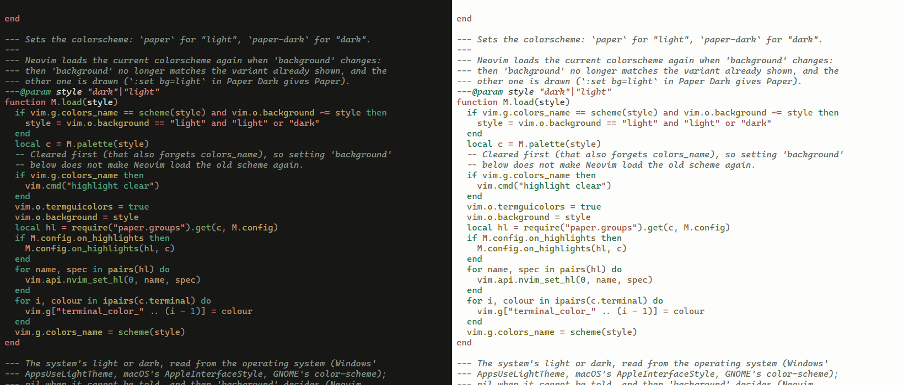

# paper.nvim

Paper and Paper Dark for Neovim: ink on paper, as the code blocks on
[dfine.tech](https://dfine.tech) are printed by day and at night, and as
[keepane](https://github.com/newdee/keepane)'s default terminal themes look.



- Vitesse's colours (keywords green, storage and operators red, strings
  terracotta) on the paper of the page: `#171716` at night, `#fdfdfb` by day.
- One accent, cinnabar: the current line's number, the current match, the
  mode on the status line, what a completion or a picker matched.
- Every text colour reads at 4.5:1 or more (WCAG AA) on the editor, the
  cursor line, floats and the selection; line numbers and borders at 3:1.
  `tests/check.lua` holds every group with a colour to it (353 of the 372
  each variant sets; the rest are underlines, bold and the like).
- Treesitter, LSP semantic tokens, diagnostics, diffs, and the plugins
  LazyVim starts with: blink.cmp, snacks, which-key, flash, gitsigns, noice,
  trouble, lualine, bufferline, mini.icons, grug-far, lazy.nvim, mason.
- Follows the system's light or dark (Windows, macOS, GNOME), and switches
  when Neovim gets the focus back after the system turned.

## Install

Neovim 0.10 or newer, with `termguicolors` (set when the colorscheme loads).

### LazyVim

`lua/plugins/colorscheme.lua`:

```lua
return {
  { "newdee/paper.nvim", lazy = false, priority = 1000 },
  {
    "LazyVim/LazyVim",
    opts = {
      -- Paper or Paper Dark as the system is; or "paper" / "paper-dark".
      colorscheme = function()
        require("paper").auto()
      end,
    },
  },
}
```

### lazy.nvim

```lua
{
  "newdee/paper.nvim",
  lazy = false,
  priority = 1000,
  config = function()
    require("paper").auto() -- or vim.cmd.colorscheme("paper-dark")
  end,
}
```

## Use

- `:colorscheme paper` (light) or `:colorscheme paper-dark`.
- `:set background=light` in Paper Dark gives Paper, and back.
- `require("paper").auto()`: the system's look now, and again when Neovim
  gets the focus back. Starting does not wait for it: on Windows the
  registry is read in-process (under a millisecond); on macOS and Linux the
  answer from last time is drawn while `defaults` or `gsettings` is asked
  in the background. Where nothing is known, `'background'` decides
  (Neovim sets it from the terminal's colours).
- lualine's `auto` theme picks up `paper` and `paper-dark` by themselves.

## Options

Call before the colorscheme loads:

```lua
require("paper").setup({
  transparent = false,     -- leave the background to the terminal
  italic_comments = true,
  on_highlights = function(hl, c)
    -- c is the palette (lua/paper/palette.lua); change groups here
    hl.CursorLine = { bg = c.bg_sel }
  end,
})
```

## Colours

`lua/paper/palette.lua` is written by `scripts/palette.mjs` from Vitesse's
colours: each one keeps its hue and only its lightness moves, until it
reads at 4.5:1 on every background text sits on, the selection included.
In Paper Dark 9 of Vitesse's colours move a little (the keyword green
`#4d9375` becomes `#54a080`), and two of the page's inks (the muted grey,
the cinnabar as text); in Paper most are darkened, since Vitesse
Light's own (a comment `#a0ada0` reads at 2.3:1 on white) are lighter than
the rule.
The cinnabar block colour stays `#dd625e` / `#b83e3c`, as in keepane;
cinnabar text uses a fitted `accent`.

```sh
node scripts/palette.mjs           # write lua/paper/palette.lua
node scripts/palette.mjs --check   # fail if it is not what the script writes
nvim --headless -u NONE -i NONE --cmd "set rtp^=." -l tests/check.lua
```

## Credits

The syntax colours are [Vitesse](https://github.com/antfu/vscode-theme-vitesse)'s
by Anthony Fu (MIT). The terminal's 16 colours are keepane's `paper` and
`paper-dark` themes.

---

## 中文

paper.nvim 是 Neovim 的 Paper（白纸黑墨）和 Paper Dark（深色纸面）配色，和
dfine.tech 的代码块、keepane 的默认终端主题是同一套颜色：Vitesse 的语法色，
纸面底色（夜 `#171716`、昼 `#fdfdfb`），唯一的强调色是朱砂。所有文字颜色在
编辑区、光标行、浮窗、选区上都不低于 4.5:1。

LazyVim 用法见上面的 `lua/plugins/colorscheme.lua`；`require("paper").auto()`
跟随系统明暗，切回 Neovim 时如果系统已经换了明暗，会跟着换。
